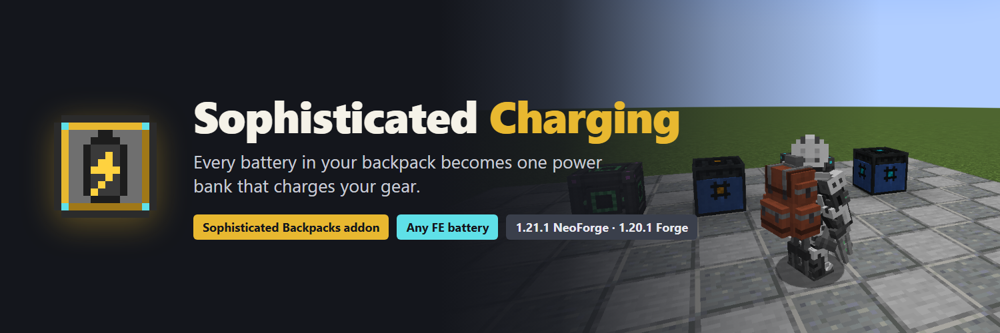
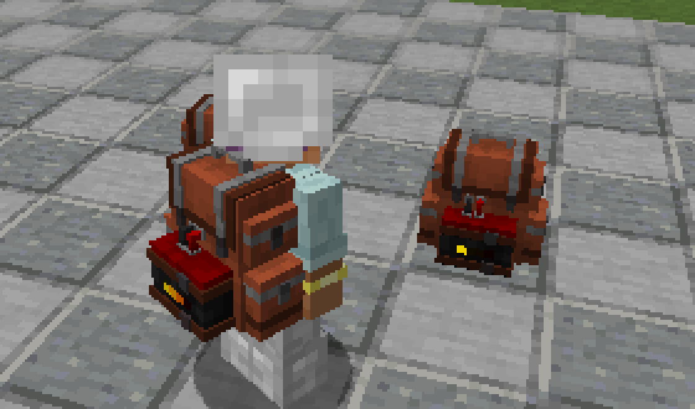
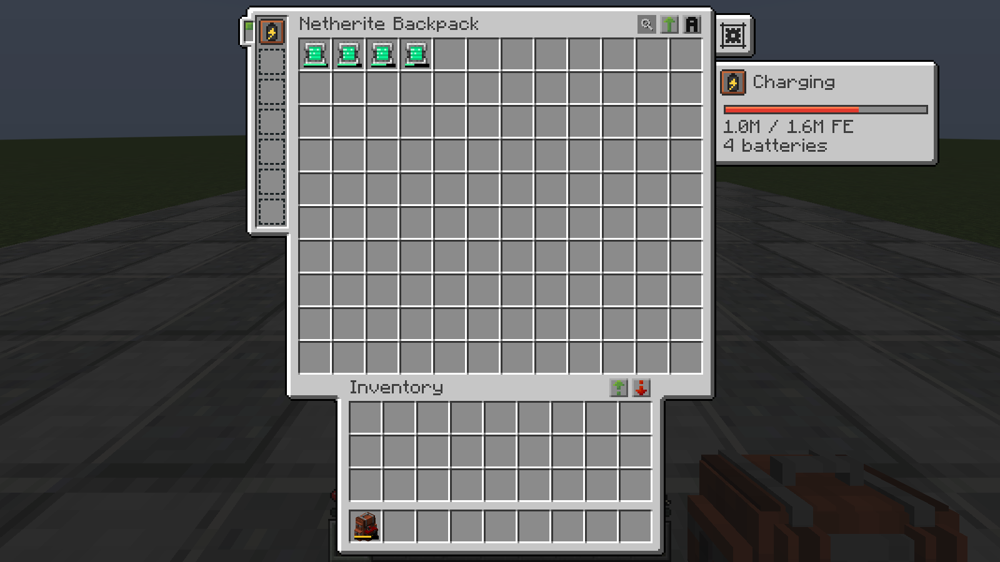
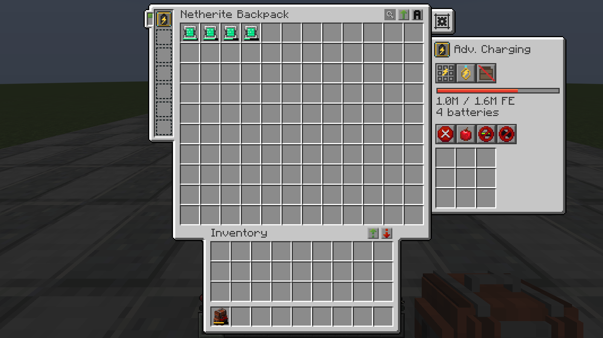
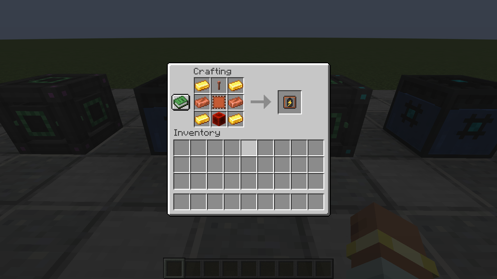
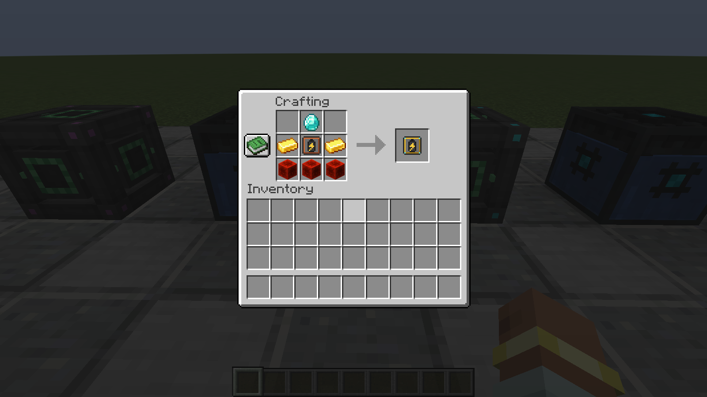

# Sophisticated Charging

An addon for [Sophisticated Backpacks](https://www.curseforge.com/minecraft/mc-mods/sophisticated-backpacks) that turns a
backpack full of batteries into one big power bank that charges your gear.



| Minecraft | Loader | Needs |
|---|---|---|
| 1.21.1 | NeoForge | Sophisticated Backpacks 3.25.9+, Sophisticated Core 1.3.89+ |
| 1.20.1 | Forge (also NeoForge 1.20.1) | Sophisticated Backpacks 3.24.9+, Sophisticated Core 1.2.105+ |

Curios is optional. Install Sophisticated Charging on both the server and the clients.

## What it adds

### Charging Upgrade
- Every battery you put in the backpack (from **any mod** that uses Forge Energy, such as Mekanism and Powah) joins one
  shared energy pool. The backpack's own Battery Upgrade joins too.
- While you carry or wear the backpack, the pool charges your **armor and the items in both hands**.
- Cables and chargers see the backpack (held or placed) as **one big battery**: put it on a charger and every battery
  inside fills up; pull from a placed backpack and they all drain.
- 1,000 FE/t by default.



### Advanced Charging Upgrade
Everything above, plus:
- 10,000 FE/t by default.
- Toggles for charging your **whole inventory**, your **Curios slots** and **tools stored in the backpack** (this also
  works for a placed backpack).
- A filter (allow or deny list, by item, mod or tag) for what gets charged.



### Crafting
One Charging Upgrade per backpack. The Advanced one is made from the basic one and keeps its settings.

| Charging Upgrade | Advanced Charging Upgrade |
|---|---|
|  |  |

## How it behaves
- The energy always stays inside the batteries. The upgrade holds none itself, so dropping, placing, copying or
  breaking a backpack can't duplicate or lose energy, and removing a battery takes its charge with it.
- Fill order: the Battery Upgrade first, then batteries from the first slot on. Drain order: the last battery first.
- Only single items count (a stack of 2 batteries would be counted twice by most mods, so stacks are skipped).
- What is a battery is detected by behaviour: an item that actually gives energy back (tested once per item type on a
  copy). Armor, tools and weapons never count, and neither do devices that only let machines drain them (Mekanism's
  MekaSuit, Meka-Tool, Portable Teleporter, Robit, ...), so gear stored in the backpack is never drained, it gets charged.
  Tested with Mekanism (Energy Tablet, energy cubes, MekaSuit and tools) and Powah (batteries and energy cells); creative
  batteries (Mekanism's creative cube, Powah's creative cell, Draconic Evolution's creative capacitor) are kept out.
- Batteries in your inventory outside the backpack are not charged (it would just move energy around, and some
  batteries charge the backpack back). Server owners can turn that on.
- Other backpacks are never charged or used as batteries (no loops).
- Charging order: helmet to boots, main hand, off hand, then (advanced) hotbar and inventory, Curios, backpack contents.

## For server owners and pack makers
Everything is in `sophisticatedcharging-server.toml`, synced to players. On 1.21.1 it is in `config/` (a copy in
`<world>/serverconfig/` overrides it for one world); on 1.20.1 it is in `<world>/serverconfig/` (put defaults for new
worlds in `defaultconfigs/`).

| Setting | Default | What it does |
|---|---|---|
| `charging.basicChargeRate` | 1000 | FE/t of the Charging Upgrade |
| `charging.advancedChargeRate` | 10000 | FE/t of the Advanced Charging Upgrade |
| `charging.chargeInterval` | 10 | charge every N ticks (rate is scaled; items still get their full per-tick speed) |
| `charging.advancedFilterSlots` | 9 | filter slots of the advanced upgrade |
| `charging.allowInventoryCharging` / `allowCuriosCharging` / `allowContentsCharging` | true | switch the advanced options off server-wide |
| `batteries.bannedBatteries` | [] | items that never count as a battery |
| `batteries.banInfiniteBatteries` | true | leave out creative/infinite batteries (detected automatically) |
| `batteries.maxBatteryCapacity` | 0 | leave out batteries bigger than this many FE (0 = no limit) |
| `chargeTargets.bannedChargeTargets` | [] | items that are never charged |
| `chargeTargets.chargeBatteriesOutsideBackpack` | false | also charge batteries in the player's inventory |

Ban list entries: `"modid:item"` (one item), `"modid:*"` or `"@modid"` (a whole mod), `"#namespace:tag"` (an item tag).

Item tags for datapacks / KubeJS:
- `sophisticatedcharging:banned_batteries`: never used in the pool (still not charged, it's a battery)
- `sophisticatedcharging:banned_charge_targets`: never charged
- `sophisticatedcharging:batteries`: always treated as a battery (if the detection misses one)
- `sophisticatedcharging:not_batteries`: never treated as a battery: never drained, charged like gear

Example: keep the biggest Draconic capacitors and everything from Powah out of the pool, and never charge the Meka-Tool:
```toml
[batteries]
    bannedBatteries = ["draconicevolution:draconic_capacitor", "draconicevolution:chaotic_capacitor", "@powah"]
[chargeTargets]
    bannedChargeTargets = ["mekanism:meka_tool"]
```

## License
MIT (see `LICENSE`): use it in any modpack, fork it, port it; just keep the copyright notice.

## Building
Each Minecraft version is its own Gradle project: `cd neoforge-1.21.1` (or `forge-1.20.1`) and `./gradlew build`; the
jar is in `build/libs/`.
